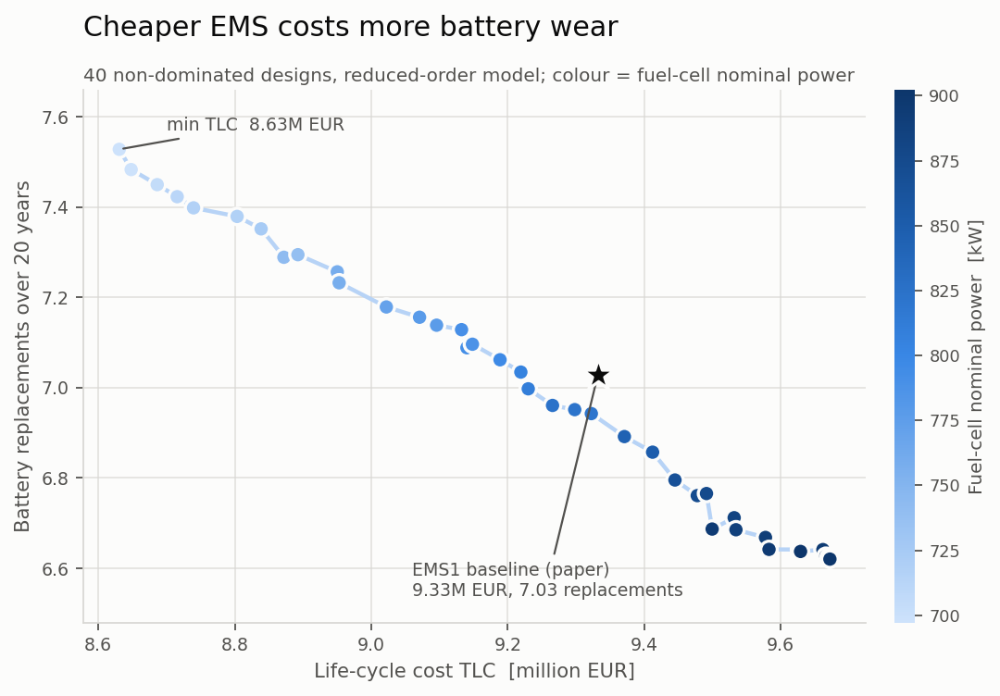
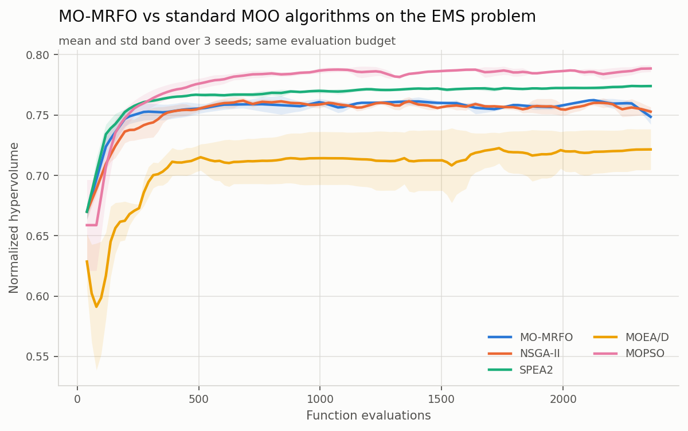
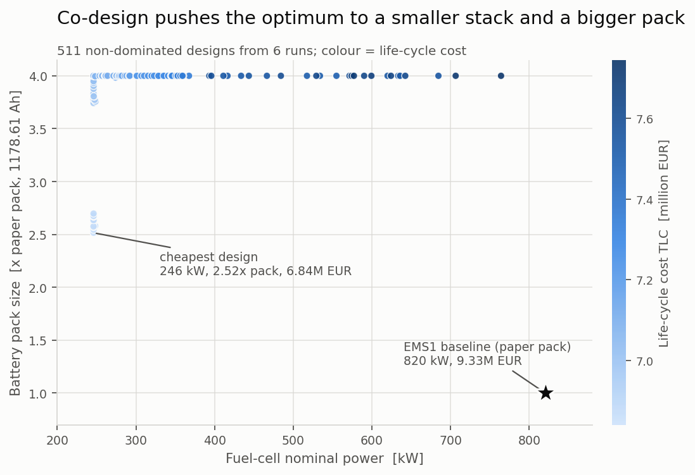

# 氢燃料电池混合动力列车能量管理：建模与多目标优化

把一篇氢燃料电池 / 锂电池混合动力列车 EMS 论文的参数体系复现成一个可运行的离线仿真模型，并在它上面做多目标优化，回答一个工程问题：

> 燃料电池该配多大、SOC 阈值该定在哪，才能在 20 年全生命周期成本、燃料电池更换次数和电池更换次数之间取得更好的折中？

本仓库是**离线仿真 + 多目标优化的工程实践**，不包含实时仿真（原因见文末）。

---

## 结果速览

| 指标 | 论文 EMS1 | Simulink 闭环基线 | Python 代理（同一策略） |
|---|---|---|---|
| 单趟耗氢 | 105.8 kg | 106.00 kg | 106.62 kg |
| 全生命周期成本 TLC | 9,191,965 EUR | 9,202,171 EUR | 9,332,345 EUR |
| 燃料电池更换次数 | 2.5 | 1.95 | 1.95 |
| 电池更换次数 | 1.57 | 7.54 | 7.03 |
| SOC 终点 | 0.423 | 0.554 | 0.522 |

Simulink 闭环基线对论文的耗氢和 TLC 偏差分别为 +0.2% 和 +0.1%；后两项差异是口径与工况问题，见 §口径。

多目标优化结果（`results/pareto_front_v2.csv`，40 个非支配解，全部满足 SOC ≥ 0.30）：

| | 最小值 | 最大值 |
|---|---|---|
| TLC | 8,630,774 EUR | 9,672,164 EUR |
| FC 更换次数 | 1.89 | 2.10 |
| 电池更换次数 | 6.62 | 7.53 |



*图：代理模型上的前沿（电池更换次数比 Simulink 系统性低约 7%，见 §高保真回填验证）。*

- 帕累托前沿把 TLC 的可选区间拉开约 **11%**（8.63M–9.67M EUR）。
- 代理模型上 **4 个前沿点严格支配 EMS1**；但高保真回填表明这个支配很勉强：3 个代表点里只有中位点严格支配（TLC −0.07%、电池更换 −0.08 次）。真正有价值的权衡在低 TLC 端：把电堆从 820 kW 降到 697 kW，TLC 降 6.8%，代价是电池更换 +0.5 次。
- 一句话结论：**EMS1 的 SOC 阈值已接近最优，可优化空间主要在电堆定容**；"EMS1 被显著支配"的说法不成立，简历里不要这么写。
- 前沿本质上是**一维的定容权衡**：FC 标称功率与 TLC 的相关系数 +0.995，与电池更换次数 −0.999。减少 FC 定容能省 CAPEX 和氢耗，代价是电池承担更多吞吐、更换更频繁。三目标前沿可作为二维权衡曲线使用。
- 前沿解在边界处堆积：`FC_nom_scale = 0.85`、`SOC_low = 0.20`、`SOC_high = 0.85`、`SOC_regen = 0.95` 均有触界，说明约束范围限制了进一步收益（见 §限制）。
- 把电池容量也放开后（§扩展决策空间），TLC 可再降约 25%–27%；但收益来自"改架构"（更小的电堆 + 更大的电池），不是 EMS 参数调优。

---

## 高保真回填验证

把 3 个前沿代表点和 EMS1 基线回填到 Simulink 闭环模型，跑完 12 000 s 单趟工况，用同一套 `compute_degradation.m` 重算（`results/verification_v2.csv`）：

| 点 | TLC 代理 | TLC Simulink | 误差 | FC 代理 / Sim | 电池代理 / Sim |
|---|---|---|---|---|---|
| Pareto 1（最低 TLC） | 8,630,774 | 8,578,142 | −0.61% | 1.89 / 1.89 | 7.53 / 8.07 |
| Pareto 2（中位） | 9,265,694 | 9,195,557 | −0.76% | 1.94 / 1.94 | 6.96 / 7.46 |
| Pareto 3（最高 TLC） | 9,672,164 | 9,505,299 | −1.73% | 2.10 / 2.24 | 6.62 / 7.10 |
| EMS1 基线 | 9,332,345 | 9,202,171 | −1.39% | 1.95 / 1.95 | 7.03 / 7.54 |

- TLC：代理高估 0.6%–1.7%，量纲一致。
- 燃料电池更换：多数点误差 ≤ 0.01 次，高功率端 +0.14 次。
- 电池更换：代理**系统性低估 7.1%–7.2%**（代理用 `I = P/Uocv`，Simulink 计入了内阻和二阶 RC 压降）。偏差近似统一的乘性系数，因此排序不变；若需要绝对值，乘 1.072 即可。

---

## 算法基准

同一模型、同一决策空间、同一评估预算（2 360 次）、3 个随机种子，比较 5 种算法（`benchmark_algorithms.py`，pymoo 实现标准算法）：

| 算法 | 归一化 HV（mean ± std） | IGD | 用时 |
|---|---|---|---|
| **MOPSO** | **0.7886 ± 0.0028** | **0.0089** | 4.6 s |
| SPEA2 | 0.7740 ± 0.0009 | 0.0241 | 3.9 s |
| NSGA-II | 0.7528 ± 0.0038 | 0.0525 | 3.6 s |
| MO-MRFO（本项目） | 0.7485 ± 0.0062 | 0.0482 | 7.1 s |
| MOEA/D | 0.7215 ± 0.0169 | 0.0841 | 5.4 s |



**结论要如实写：MO-MRFO 没有胜出**，HV 与 NSGA-II 同级、低于 MOPSO 和 SPEA2。原因是这个问题的前沿接近一维且最优解压在可行性边界上，MRFO 的算子没有发挥空间；MOEA/D 对目标尺度敏感，做了 TLC/1e6 缩放后才恢复正常。

更有价值的发现来自决策空间本身：把电堆定容降到 0.80×820 kW 时 SOC 会跌破 0.30（不可行），0.85× 刚好可行（SOC_min = 0.319）。也就是说**电堆已经处在"再小就带不动"的可行性边界上**，TLC 的全部可优化空间约 7%，换任何算法都改变不了这个上限。

---

## 扩展决策空间：电堆与电池协同定容

既然瓶颈是"电池容量被钉死在 1178.61 Ah"，就把它也放开：增加第 6 个决策变量 `bat_scale`（电池容量相对论文包的倍数，0.6–4.0），电堆定容下限放宽到 0.30×（246 kW）。大电池会带来额外质量（论文 Table 10：每倍容量 8920 kg），因此每个候选解都按 `195 t + (bat_scale−1)×8.92 t` 重新计算牵引/再生功率，`bat_scale=1` 时与原五变量问题逐位一致。

`experiment_codesign.py`，MOPSO 与 NSGA-II 各 3 个种子，每个 8 000 次评估，合并 6 次运行的档案后重新做非支配筛选：

| | 五变量（电池固定） | 六变量协同定容 |
|---|---|---|
| TLC 最小值 | 8,630,774 EUR | **6,841,500 EUR（−26.7%）** |
| 电堆功率 | 697–902 kW | 246–764 kW |
| 电池容量 | 1,178.61 Ah | 2,964–4,714 Ah（2.5×–4.0×） |
| 燃料电池更换 | 1.89–2.10 | 1.68–1.97 |
| 电池更换 | 6.62–7.53 | 0.82–2.00 |



最便宜的设计：**246 kW 电堆 + 2 964 Ah 电池**（SOC_low 0.263、SOC_high 0.785、怠速 123 kW、再生上限 0.899），单趟耗氢从 106.6 kg 降到 24.1 kg，电池更换从 7.03 次降到 2.00 次。

**这个结果的正确读法（也是它的限制）**：

1. **低 TLC 端对电堆定容不敏感**：前沿上 79% 的解落在 `FC_nom_scale=0.30` 下界附近，但把定容从 123 kW 扫到 328 kW，TLC 只在 6.84–6.95M 之间变化——氢耗随之从 15.8 升到 29.9 kg，电池更换却从 2.11 降到 1.95，两者基本抵消。所以这不是"电堆越小越好"，而是**在 2.5× 电池下，120–330 kW 的电堆都落在同一成本平台上；真正的杠杆是电池容量（架构），不是 EMS 参数**。
2. **大电池会撞上 EMS1 的控制边界**：容量超过约 4× 后，SOC 全程高于状态机的 60 % 恢复阈值，电堆永不离开怠速，目标值对电堆定容完全不敏感——这是固定控制律的退化区，不能当作真实设计。因此上限取 4.0×。
3. **成本在更换次数处不连续**：REPLEX 用 `floor`，容量微调会让 20 年内的电池更换次数从 1 跳到 2，TLC 跳变约 17 万欧元。最低点 6.84M 与相邻的 7.01M 只差一次更换，应读作"约 6.8–7.0M（−25%～−27%）"，不要报到 4 位有效数字。
4. 电池寿命按论文 Eq. (14) 的写法随容量增大而变长（`N_cyc_EoL ∝ C^0.786`）。这是论文公式的推论，换一种循环计数口径结论会变，需要单独做敏感性分析。
5. 这些点**没有做 Simulink 高保真回填**：闭环模型的电池容量与整车质量需要同步改参数，超出当前标定范围。协同定容的数字只能作为代理模型上的设计空间探索。

---

## 技术路线

1. **参数提取与建模**：从论文正文、图表和补充材料提取列车阻力、传动效率、电堆极化曲线、电池 EECM 和退化参数，用脚本 `build_simulink_model_v5.m` 自动生成 Simulink 模型（含 PLECS 电热模块）。
2. **标定**：以论文中自洽性最强的耗氢量（105.8 kg/趟，0.596 kg/km）为锚点，校准 Davis 阻力常数、牵引/再生效率和燃料电池化学计量因子。
3. **降阶代理**：把闭环模型写成 numba 加速的 Python 状态机 + 解析退化/成本模型，单趟评估约 1–2 ms（0.5 s 步长），供群体智能算法调用（`mrfo_multiobjective_v2.py`）。
4. **多目标优化**：MRFO 的链式、螺旋、翻腾觅食算子负责生成，NSGA-II 的快速非支配排序 + 拥挤距离负责选择。
5. **回填验证**：把前沿代表点回填到 Simulink 闭环模型，用同一套退化/成本公式重算，比较代理与高保真模型的偏差（`verify_pareto.m`）。

### 决策变量与目标

| 变量 | 含义 | 下界 | 上界 |
|---|---|---|---|
| `SOC_low` | 低 SOC 阈值 | 0.20 | 0.35 |
| `SOC_high` | 高 SOC 阈值 | 0.60 | 0.85 |
| `FC_nom_scale` | 电堆标称功率 / 820.3 kW | 0.85 | 1.10 |
| `FC_idle_scale` | 电堆怠速功率 / 820.3 kW | 0.15 | 0.35 |
| `SOC_regen` | 再生制动允许 SOC 上限 | 0.80 | 0.95 |
| `bat_scale` | 电池容量 / 1178.61 Ah（仅协同定容实验） | 0.6 | 4.0 |

目标：最小化 `TLC`、`N_rep_FC`、`N_rep_BAT`。氢气成本已计入 TLC 的 OPEX，不再单列目标（早期四目标版本会让前沿过度拥挤，见 `mrfo_multiobjective.py`）。

---

## 仓库结构

```text
mrfo_multiobjective_v2.py   主脚本：代理模型 + MO-MRFO（最终版）
plot_tradeoff.py            从 CSV 渲染权衡图（README 头图）
benchmark_algorithms.py     5 种 MOO 算法的 HV/IGD 基准（pymoo）
experiment_codesign.py      电堆 + 电池容量协同定容（6 变量）
plot_codesign.py            协同定容前沿图
compute_degradation.m       退化与 TLC 计算（MATLAB 与 Python 共用的唯一口径）
params.m                    模型参数（论文表 5/10 等）
build_simulink_model_v5.m   Simulink 模型自动生成脚本
verify_pareto.m             前沿代表点回填 Simulink，与代理结果对比
mrfo_calibrated.py          单目标 MRFO 标定脚本（复现耗氢基线）
mrfo_multiobjective.py      早期四目标版本（保留作对照）
speed_points.txt            线路速度曲线（12 000 s）
accel_points.txt            线路加速度曲线
slope_points.txt            线路坡度
results/                    前沿 CSV 与图
docs/                       交接说明、代码审计与建模报告
tests/                      一致性测试
```

---

## 快速开始

### Python（优化部分，约 1 分钟）

```bash
python -m pip install -r requirements.txt
python mrfo_multiobjective_v2.py
```

输出 `results/pareto_front_v2.csv`、`pareto_scatter_v2.png`、`pareto_parallel_v2.png`。随机种子固定为 0，结果可复现。

```bash
python plot_tradeoff.py       # 生成 results/tradeoff_v2.png
python -m pip install -r requirements-dev.txt
python benchmark_algorithms.py  # 算法基准，约 2 分钟
python experiment_codesign.py   # 协同定容，约 2 分钟
python plot_codesign.py         # 生成 results/codesign_pareto.png
```

### MATLAB（高保真验证，需要 Simulink）

```matlab
cd <仓库目录>
verify_pareto                     % 读取 results/pareto_front_v2.csv
```

脚本会重建模型、跑完 12 000 s 单趟工况，用 `compute_degradation.m` 重算指标，并写出 `results/verification_v2.csv`。

### 测试

```bash
python -m pytest tests -q
```

---

## 口径说明（最重要的一节）

三处与论文的差异都不是代码 bug，而是**论文未定义清楚的口径**。仓库选择物理自洽的口径，并把差异写在这里，而不是把数字凑到论文上。

### 1. 电池更换次数：7.03 vs 1.57

电池退化用 Wang et al. (2011) 的非线性模型：

```text
Closs = A·exp(-B/(R·T))·(cycles·C_bat)^0.56
```

20% 容量损失对应约 **2042 个等效满放循环**。本仓库把 `cycles` 解释为**累计放电安时 / 额定容量**：

- 每趟累计放电约 1.0 个等效循环（含牵引放电和再生制动来回吞吐）；
- 电池寿命约 2042 趟；
- 14 400 趟 / 2042 ≈ **7.0 次更换**。

论文的 1.57 次反推为每趟 **0.22 个等效循环**。按论文自己的 SOC 曲线（0.90 → 0.423），仅净放电就有

```text
0.477 × 1178.61 Ah × 1500 V ≈ 843 kWh
843 / 1767.9 ≈ 0.48 个等效满放循环
```

即论文的 0.22 ≈ **净放电循环数的一半**，符合"一次充放（充+放）算一个等效循环"的 EFC 惯例，而 Wang 模型统计的是**累计放电吞吐**。

所以准确的结论是：**论文没有声明循环计数的口径**，其 1.57 次对应 EFC≈净放电/2；本仓库用累计放电安时口径，代理模型得到 7.0 次、Simulink 闭环 7.5 次（差异来自内阻压降，见 §高保真回填验证）。两者不矛盾，但不可直接比较。为了让口径可审计，`compute_degradation.m` 同时输出 `cycles_equiv`、`Ah_discharge` 和 `N_life`。

### 2. 燃料电池更换次数：1.95 vs 2.5

退化公式与论文完全一致（`Vdeg = n1·V1 + t1·U1 + n2·V2 + t2·U2`），差异来自工况：

- 论文 EMS1 每趟负载切换 `n2 = 28` 次，本项目闭环模型只有 3 次；
- 论文 SOC 在 60%/70% 阈值附近频繁穿越，本项目 SOC 更平稳（终值 0.522 vs 0.423）。

代价是论文的 `n2·V2 ≈ 11.7 µV`、本项目约 1.26 µV。公式没改，改的是轨迹。

### 3. SOC 终点：0.52（代理）/ 0.55（闭环） vs 0.423

论文同时给出耗氢 105.8 kg、SOC 终点 42.3% 和"SOC 保持 30%–70%"三条信息，但公开的参数不足以同时满足。仓库以耗氢为锚点（论文中耗氢与 kg/km 两项互相印证），SOC 终点随之落在 0.52 附近。试过提高 Davis 阻力把 SOC 压到 0.42，代价是耗氢涨过论文值。

---

## 本次修正（2026-11-13）

审阅实现时发现并修复了以下问题，修正后基线 TLC 为 9.33M，前沿全部重跑：

| 问题 | 修正 |
|---|---|
| `CAPEX_FC` 用固定 820.3 kW，不随决策变量变化 | 按 `FC_nom` 缩放 |
| 怠速判据硬编码 250 kW，与可变的 `P_idle` 脱节 | 改为 `P_idle + 50 kW` |
| 电池放电电流用固定 1500 V | 改用实际开路电压 `Uocv(SOC)` |
| OPEX 按 730 趟/年折算，与 14 400 趟/20 年不符 | 统一为 720 趟/年 |
| 无可行性约束，SOC < 0.30 的解也可能进入前沿 | 加入可行性惩罚，前沿全部满足 SOC ≥ 0.30 |
| `verify_pareto.m` 复制了一份带上述 bug 的成本函数 | 删除副本，改为调用唯一的 `compute_degradation.m` |

---

## 限制

- **代理模型精度**：0.5 s 步长、`I = P/Uocv` 近似（略去内阻与二阶 RC 动态）。回填 Simulink 后 TLC 高估 0.6%–1.7%，电池更换次数系统性低估约 7.2%（乘性偏差，排序不变）；燃料电池更换次数误差 ≤ 0.14 次。
- **前沿接近一维**：三个目标强相关，实际信息量接近"电堆定容—电池吞吐"二维权衡。
- **决策空间受限**：`FC_nom_scale` 等变量触界，扩大边界可能带来更大收益，但会超出标定工况，需要重新验证代理模型。协同定容实验（§扩展决策空间）表明收益可达 25%–27%，但最优解把电堆推到新下界，且电池寿命随容量的缩放依赖论文 Eq. (14) 的写法；那些点没有做 Simulink 回填，只能作为设计空间探索。
- **单次运行单种子**：`seed=0`。生产使用应做多种子 + 超体积指标（HV）收敛性分析。
- **不做实时仿真**：论文的实时部分是在 Speedgoat P3 上固定步长跑模型的执行演示（0.1 s 步长、0.07 s 延迟），明确 "without external hardware coupling"、无物理 I/O，不构成 HIL，也不影响 EMS/退化/成本结论。本机 MATLAB R2018b 的 sldrt 内核在 Windows 11 上会触发蓝屏（0x1E / rtwtkrnl.sys），复现它没有工程价值。

---

## 参考

- Pozzessere et al., *Hydrogen fuel cell hybrid train: real-time simulation and energy management strategy*, Int. J. Hydrogen Energy 216 (2026) 153737.
- Wang et al., *Cycle-life model for graphite-LiFePO4 cells*, J. Power Sources 196 (2011).
- 实现修正、口径澄清与范围决策：`docs/MEMS_revisions_20261113.md`。
- 早期交接与参数审计：`docs/MEMS_handoff_20260826.md`、`docs/MEMS_code_audit_20260826.md`（历史记录，冲突处以修订记录为准）。

## 许可证

MIT，见 `LICENSE`。
